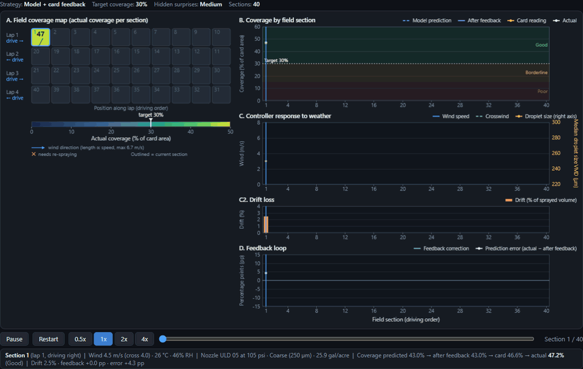
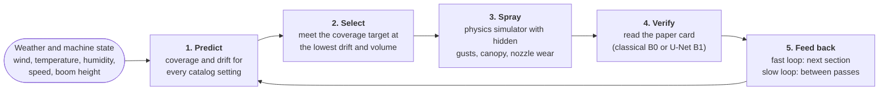
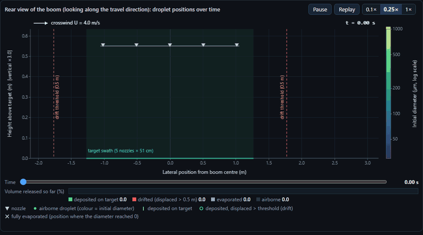
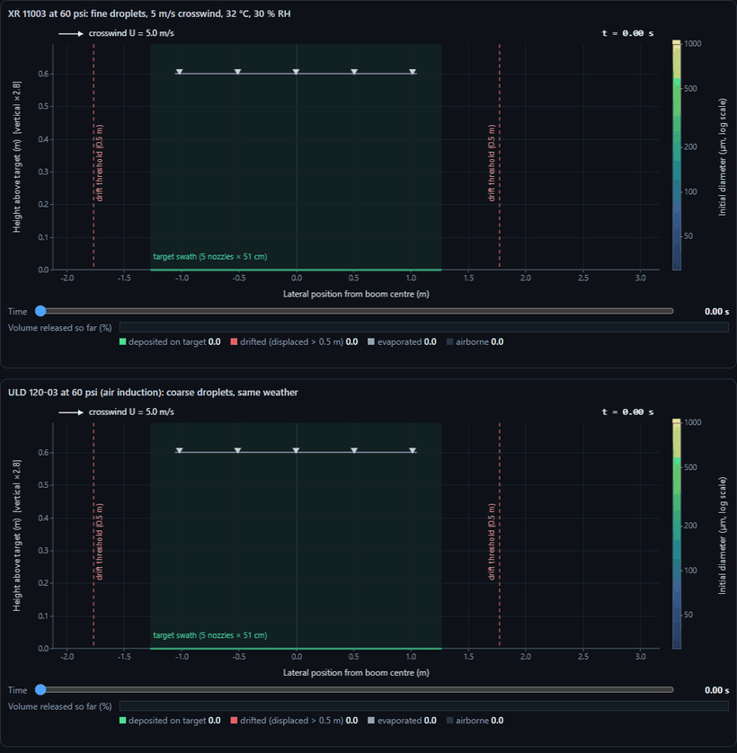
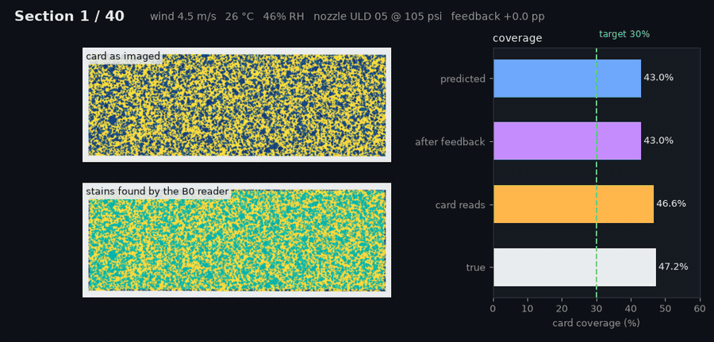
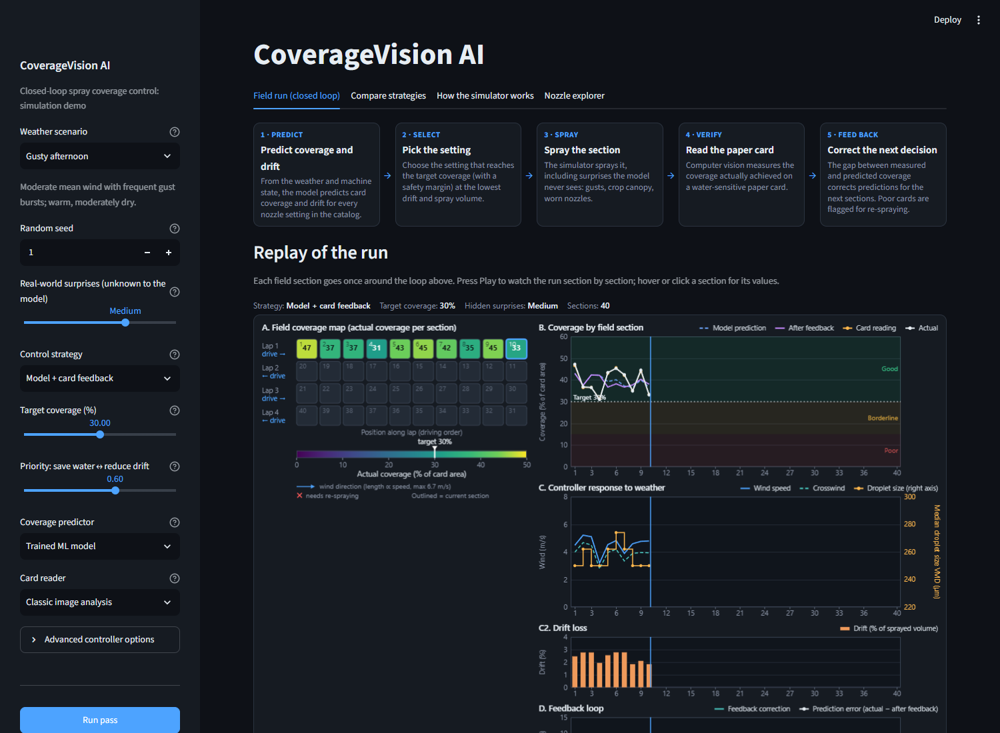
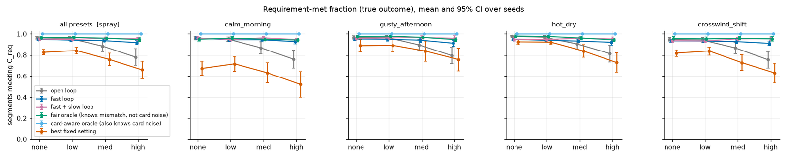
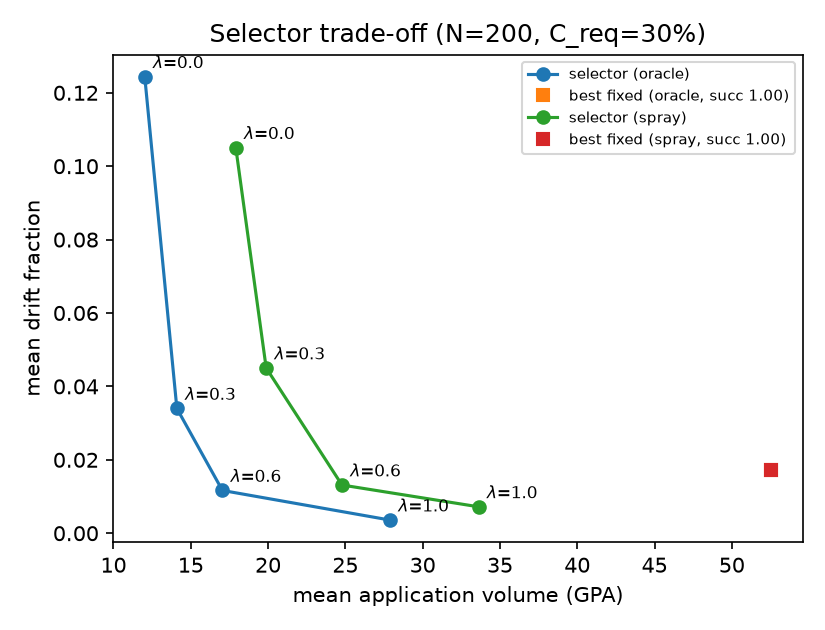
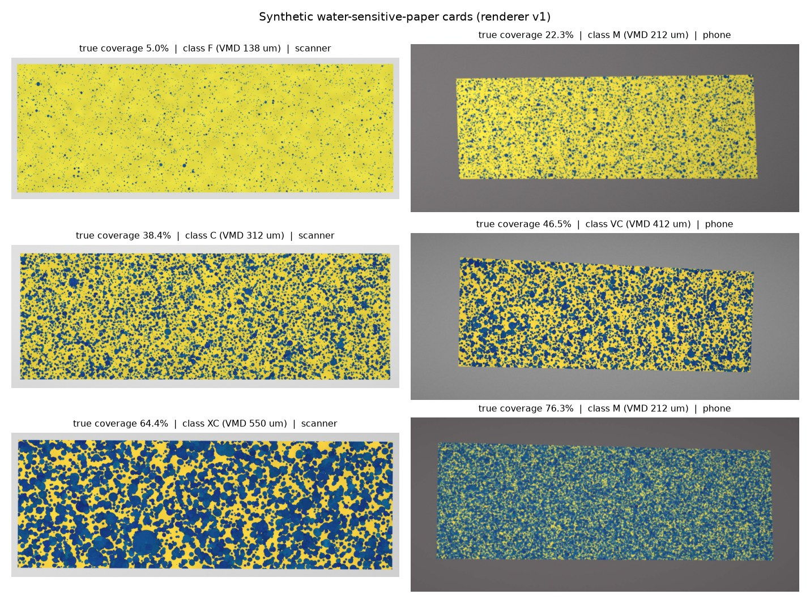

<div align="center">

# CoverageVision AI

**A sprayer that checks its own work.** It predicts spray coverage, picks the nozzle, sprays, reads a water-sensitive paper card with computer vision, and corrects itself section by section.

Closed-loop precision spraying, evaluated in a physics-informed simulator (ABE 598, Fall 2026).

    -EE4C2C?logo=pytorch&logoColor=white) 



<sub>A full pass over a 40-section field on a gusty afternoon, with hidden gusts, canopy and nozzle wear the model never sees. Each tile is a field section coloured by the coverage it actually got; the charts track predicted vs. measured coverage, the weather the controller reacted to, drift, and the feedback correction. Result: 36 / 40 sections on target, 2.1 % mean drift, nothing to re-spray.</sub>

</div>

## How it works

For each field section the system:

1. predicts coverage and drift risk from the measured conditions (wind, temperature, humidity, speed, boom height) for every catalog setting,
2. picks the setting (nozzle, pressure, optionally travel speed and boom height) that meets the coverage requirement at the lowest predicted drift and volume,
3. sprays (in the simulator),
4. reads the coverage actually achieved from a rendered water-sensitive-paper (WSP) card with computer vision (classical B0 or U-Net B1),
5. feeds the error back: a fast loop corrects the next section, a slow loop corrects the model between passes.



Planning and design history: `PLAN.md`, `Docs/decisions.md`. Open work for the next session: **`Docs/NEXT_STEPS.md`**.

## See it in action

### Inside the spray: droplets, wind and evaporation



The *How the simulator works* tab of the app. Five XR 11003 nozzles at 40 psi spray into a 4 m/s crosswind (28 °C, 40 % RH), seen from behind the sprayer. Each dot is a droplet coloured by its starting size; it shrinks as it evaporates. The bar counts where the spray volume ends up: on the target strip, blown more than 0.5 m sideways (drift), or evaporated.

### Same weather, different nozzle



Hot, dry and windy (5 m/s crosswind, 32 °C, 30 % RH). The fine-droplet **XR 11003** (VMD 128 µm) loses **43.7 %** of its volume to drift and evaporation. The air-induction **ULD 120-03** (VMD 275 µm) at the same size and pressure loses **3.3 %**. This trade-off is what the selector weighs for every section.

### Reading the card



Every section leaves a rendered water-sensitive paper card (scanner or phone-camera look). The classical B0 reader segments the blue stains (teal overlay). The bars show the loop's numbers for that section: the model's prediction, the prediction after feedback, what the card reads, and the true coverage. The gap between *card reads* and *after feedback* is the error the next section corrects for.

### The demo app



Four tabs: **Field run** (the closed loop above, with per-section card, chosen nozzle and selector ranking), **Compare strategies** (open loop vs. feedback vs. oracles), **How the simulator works** (the spray lab), and **Nozzle explorer**. Settings can be preset in the URL, for example `http://localhost:8501/?preset=hot_dry&mismatch=high&policy=fast`.

## Results at a glance

All numbers are simulator-internal. Brackets are 95 % paired-bootstrap CIs over 20 seeds (closed loop); the other rows are single evaluations without a CI. Full table with sources: [`results/scorecard.md`](results/scorecard.md).

| Component | Target (proposal) | Result |
|---|---|---|
| Closed loop, fast + slow | recover ≥ 50 % of the open-loop-to-oracle gap with ≤ 10 % more volume | **96 %** [80, 107] of the gap, +4.1 % [+2.8, +5.5] volume |
| Setting selector | meet the target in ≥ 90 % of scenarios, less drift than the best fixed setting | **97 %** of 200 scenarios, 24.8 vs 47.5 gal/acre and 0.013 vs 0.017 drift |
| Coverage model (LightGBM) | MAE ≤ 3 pp, better than linear | **2.84 pp** vs 3.32 pp (ridge) |
| Card reader, U-Net B1 | MAE ≤ 2 pp, ≥ 90 % class agreement | **0.20 pp**, 99.4 % on our cards; 1.74 pp, 88.3 % on the Simões cards |



<sub>Share of sections meeting the coverage target as the hidden mismatch grows. Without feedback (grey) and with one fixed nozzle (orange) the share falls; with card feedback (blue, pink) it stays close to the fair oracle (green).</sub>

<table>
<tr>
<td width="50%"><br><sub>Selector trade-off: the λ weight moves the choice between less volume and less drift.</sub></td>
<td width="50%"><br><sub>Synthetic WSP cards from 5 % to 76 % coverage, scanner and phone looks.</sub></td>
</tr>
</table>

Not everything worked. The wind forecaster, boom-height control and the hybrid physics + ML predictor were evaluated and not adopted, and accuracy on real cards is untested because the annotated real-card set is restricted. The negative results are listed in [`results/scorecard.md`](results/scorecard.md).

## Setup

Needs Python 3.12+ (the repo pins 3.14 in `.python-version`) and [uv](https://docs.astral.sh/uv/).

```bash
git clone https://github.com/MasterKinjalk/coverageai.git
cd coverageai
bash scripts/setup.sh            # Linux / macOS / Git Bash
# or, in PowerShell:  ./scripts/setup.ps1
```

The script installs uv if missing, runs `uv sync --extra vision` (numpy, LightGBM, OpenCV, Streamlit, torch, segmentation-models-pytorch, pytest), swaps in a CUDA build of torch when `nvidia-smi` is found, regenerates the 50k-row training table `data/datasets/v1.parquet`, and runs the smoke test.

Options (both scripts): `--cuda cu128` picks the CUDA wheel index (default `cu128`, use `none` to keep the CPU torch), `--with-cards` also renders the 1200 synthetic WSP cards (~3 GB, needed for U-Net training/eval), `--with-simoes` downloads the open Simões 2025 synthetic cards (~850 MB, needed for the out-of-generator check).

Manual install, if you prefer:

```bash
uv sync --extra vision
# CUDA torch (pick the index that matches your driver; see https://pytorch.org)
uv pip install --reinstall torch torchvision --index-url https://download.pytorch.org/whl/cu128
uv run --no-sync python experiments/make_dataset.py
uv run --no-sync python -m coverageai.e2e --smoke
```

**After installing CUDA torch, use `uv run --no-sync ...`** (or `export UV_NO_SYNC=1`). A plain `uv run` re-syncs to the lock file and puts the CPU torch back.

Without uv: `pip install -e ".[vision]" pytest`.

## What is in git and what is regenerated

| Item | In git? | How to get it |
|---|---|---|
| `models/unet_v1.pt` (B1 U-Net, full GPU training, 16 MB) | yes | retrain: `Docs/gpu_training.md` |
| `models/spray_model_v1.joblib` (LightGBM + CQR) | yes | `uv run python experiments/train_eval_model.py` |
| `models/hybrid_v1.joblib`, `models/hybrid_misspec_v1.joblib` | yes | `uv run python experiments/eval_hybrid.py --stage train` |
| `data/catalog/*.csv` (nozzle catalog) | yes | - |
| `data/datasets/v1.parquet` (training table) | no | `uv run python experiments/make_dataset.py` |
| `data/synthetic/v1` (rendered WSP cards, ~3 GB) | no | `uv run python -m coverageai.vision.render --out data/synthetic/v1 --n 1200 --seed 0` |
| `data/external/simoes2025` (~850 MB) | no | `uv run python -m coverageai.vision.real_data --download --summary` |
| `models/unet_v1_cpu_partial.pt`, `models/unet_v1.last.pt` | no | old checkpoints, not needed |

## Running things

```bash
uv run streamlit run app/main.py          # demo app, http://localhost:8501 (?speed=1&boom=1&forecast=ar1 presets the opt-in controls)
uv run pytest -q                          # tests
uv run python -m coverageai.e2e --smoke   # end-to-end smoke pass
uv run python -m coverageai.e2e --real --model spray --verifier b1
uv run --no-sync python reports/final/build.py   # final report (html + pdf) and results/scorecard.md
uv run --no-sync python experiments/readme_media.py   # README GIFs and screenshot -> Docs/media/ (needs Chrome/Edge + ffmpeg)
```

Experiments (each writes `results/<name>.json` + `.md`, figures in `experiments/figures/`):

| Script | What |
|---|---|
| `experiments/closed_loop.py` | main closed-loop result: open / fast / fast+slow vs fair and card-aware oracles, 20 seeds (`results/closed_loop_summary.md`) |
| `experiments/eval_selector.py` | selector success / drift / volume on no-mismatch scenarios |
| `experiments/eval_verifiers.py` | B0 vs B1 card reading on renderer and Simões cards (`results/verification_summary.md`) |
| `experiments/eval_speed_control.py`, `eval_boom_control.py` | travel speed and boom height as optional controlled settings (`results/boom_control_eval.md`, verdict at the top) |
| `experiments/eval_forecast.py` | short-horizon wind forecaster, 20 seeds (`results/forecast_eval.md`; negative result) |
| `experiments/eval_hybrid.py` | physics + learned residual predictor, offline / selector / 20-seed closed loop (`results/hybrid_eval.md`) |
| `experiments/slow_loop_diagnostic.py` | slow-loop residuals per pass |

All criteria and extensions in one table: `results/scorecard.md` (written by `reports/final/build.py`).

Most experiments take `--workers N`; on a big machine raise it (the laptop runs used 4 to 7). U-Net training on GPU: `Docs/gpu_training.md` or `notebooks/train_unet_gpu.ipynb`.

## Layout

```
src/coverageai/      library
  contracts.py       shared data types (Setting, Conditions, SegmentLog, ...), schema version
  catalog.py         nozzle catalog, derived quantities (GPA, droplet size), speed/height grids
  simulator.py       physics plant with hidden mismatch (gusts, canopy, wear)
  scenarios.py       weather presets
  selector.py        constrained setting selector
  loop.py            closed loop: policies, run_pass, run_passes_slow, fair oracle
  feedback.py        fast-loop bias, slow-loop ResidualCorrectedModel
  forecast.py        wind forecasters (persistence, EWMA, AR(1), gust-aware)
  model/             SprayModel (LightGBM + CQR), PhysicsResidualModel (hybrid), features
  vision/            WSP card renderer, classical reader (B0), U-Net (B1), Simões data loader
  app_logic.py, field_anim.py, spray_lab.py   back end of the Streamlit app
app/                 Streamlit app (main.py, field run and spray lab views)
config/spec.yaml     all parameters, ranges and selector options
experiments/         evaluation scripts and figures
results/             experiment outputs (json, md, csv)
reports/midterm/     midterm report (build.py -> html/pdf)
reports/final/       final report (build.py -> html/pdf, also writes results/scorecard.md)
Docs/                proposal, specs, decisions log, GPU training guide, NEXT_STEPS.md
Docs/media/          README animations and screenshot (experiments/readme_media.py)
tests/               pytest suite
```

## Known issues

* On the old Windows laptop, three tests that write parquet failed with a pyarrow DLL error (`test_smoke_pass`, `test_e2e_run_real_writes_logs`, `test_logs_frame_and_save`). This was laptop-specific: on the new Windows 11 machine the full suite (411 tests) passes.
* Timing tests (`test_render_time_under_one_second_worst_case`) can fail when the machine is busy.
