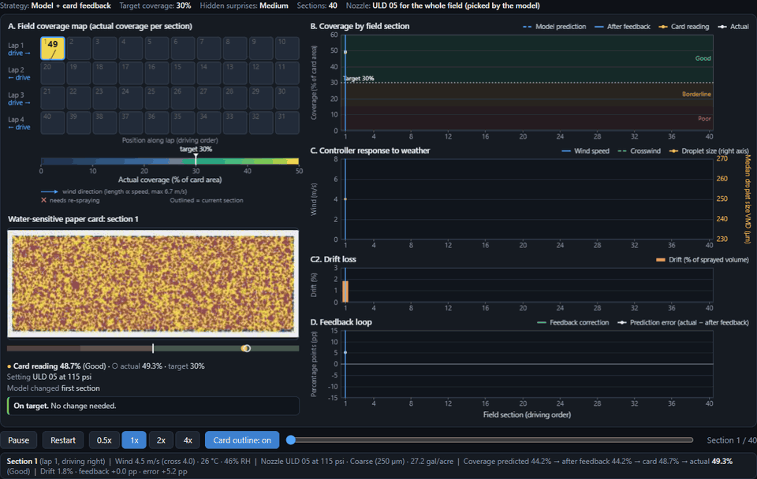
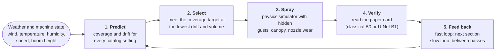
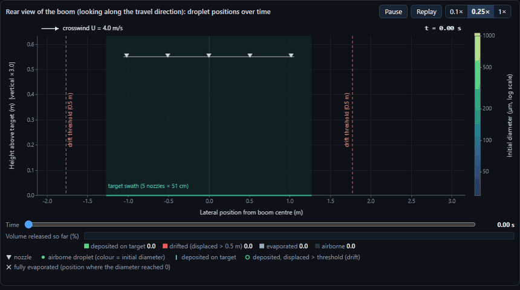
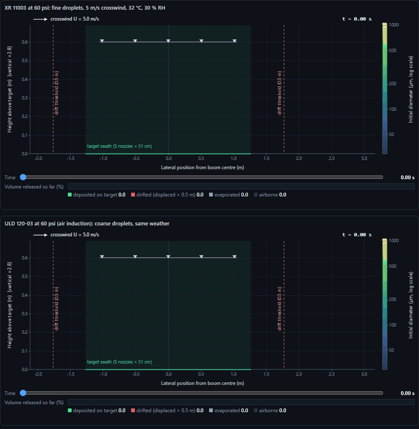
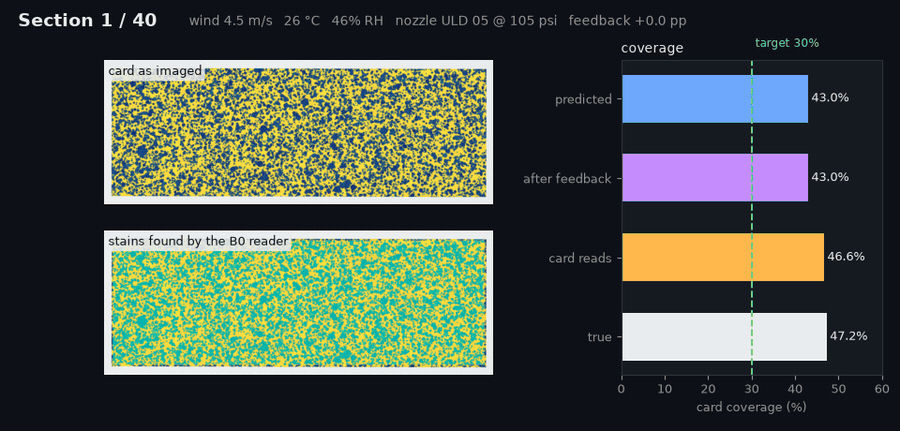
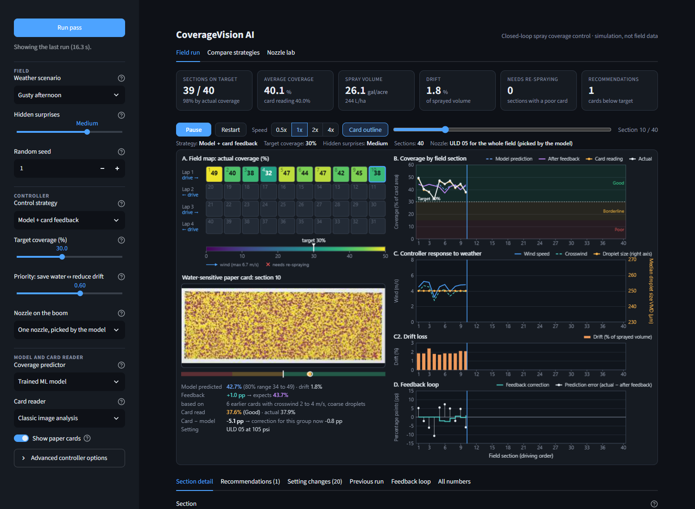
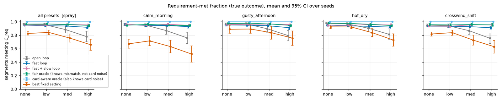
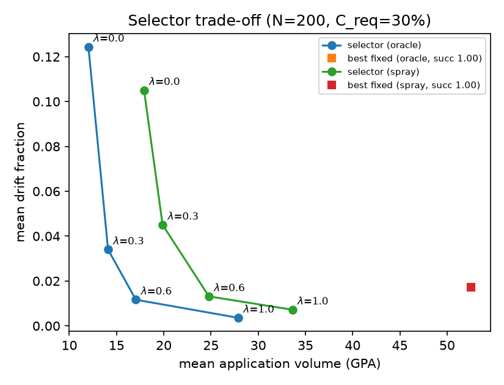
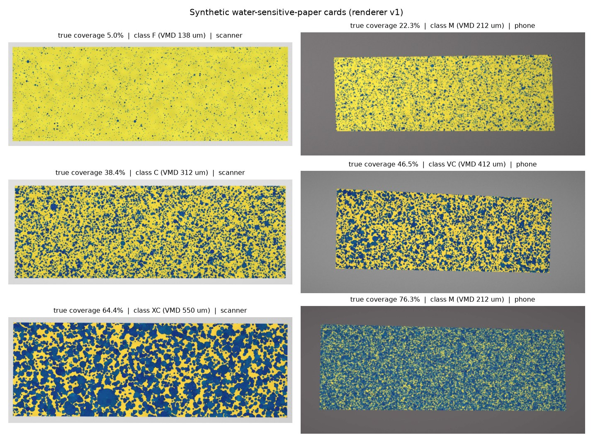

<div align="center">

# CoverageVision AI

**A sprayer that checks its own work.** It predicts spray coverage, picks the nozzle, sprays, reads a water-sensitive paper card with computer vision, and corrects itself section by section.

Closed-loop precision spraying, evaluated in a physics-informed simulator (ABE 598, Fall 2026).

    -EE4C2C?logo=pytorch&logoColor=white) 



<sub>A full pass over a 40-section field on a gusty afternoon, with hidden gusts, canopy and nozzle wear the model never sees. Each tile is a field section coloured by the coverage it actually got. Under the map is the paper card of the section being sprayed, with the stains the card reader found, and the section's numbers in loop order: what the model predicted, the feedback correction and what it is based on, what the card read. The charts track predicted vs. measured coverage, the weather the controller reacted to, drift, and the feedback correction. One nozzle is held for the whole field and only the pressure changes. Result: 39 / 40 sections on target, 1.8 % mean drift, nothing to re-spray.</sub>

</div>

## How it works

For each field section the system:

1. predicts coverage and drift risk from the measured conditions (wind, temperature, humidity, speed, boom height) for every catalog setting,
2. picks the setting (nozzle, pressure, optionally travel speed and boom height) that meets the coverage requirement at the lowest predicted drift and volume,
3. sprays (in the simulator),
4. reads the coverage actually achieved from a rendered water-sensitive-paper (WSP) card with computer vision (classical B0 or U-Net B1),
5. feeds the error back: a fast loop corrects the next section, a slow loop corrects the model between passes.



Planning and design history: `PLAN.md`, `Docs/decisions.md` (D1 to D29). Open work for the next session: **`Docs/NEXT_STEPS.md`**.

## See it in action

### Inside the spray: droplets, wind and evaporation



The *Nozzle lab* view of the app. Five XR 11003 nozzles at 40 psi spray into a 4 m/s crosswind (28 °C, 40 % RH), seen from behind the sprayer. Each dot is a droplet coloured by its starting size; it shrinks as it evaporates. The bar counts where the spray volume ends up: on the target strip, blown more than 0.5 m sideways (drift), or evaporated.

### Same weather, different nozzle



Hot, dry and windy (5 m/s crosswind, 32 °C, 30 % RH). The fine-droplet **XR 11003** (VMD 128 µm) loses **43.7 %** of its volume to drift and evaporation. The air-induction **ULD 120-03** (VMD 274 µm) at the same size and pressure loses **3.3 %**. This trade-off is what the selector weighs for every section.

### Reading the card



Every section leaves a rendered water-sensitive paper card (scanner or phone-camera look). The classical B0 reader segments the blue stains (teal overlay). The bars show the loop's numbers for that section: the model's prediction, the prediction after feedback, what the card reads, and the true coverage. The gap between *card reads* and *after feedback* is the error the next section corrects for.

### The demo app



Start it with `uv run --no-sync streamlit run app/main.py` and open http://localhost:8501. The first page load runs one pass with the defaults (trained model, classic image analysis, paper cards on), which takes about 15 to 20 s. Pick **Perfect reading** as the card reader for runs of about a second.

Four views, picked with the tabs at the top: **Field run**, **Compare strategies**, **Nozzle lab** and **Operator console**. One rule holds for all four (decisions D23, D32): the sidebar holds the inputs of the view on screen with its one Run button on top, and the main area holds results. Only the view on screen is computed, and inputs keep their values when you change view. When an input changes after a run, a line under the Run button says so; the results on screen stay those of the last run until you press it again.

The **Field run** view has these parts, top to bottom:

* Run-level results in one row.
* One animated replay. The field map, the water-sensitive paper card of the section being sprayed (with the outline the card reader found), and the coverage, weather, drift and feedback panels all move on one timeline. Play, speed and scrub controls sit above it. `?cards=0` turns the card pictures off.
* Under the card, six rows follow the section round the loop (decision D28): the model's prediction with its 80 % range and predicted drift, the feedback correction applied, what that correction is based on (for example "5 earlier cards with crosswind 2 to 4 m/s, coarse droplets"), the card reading, the error the next correction is built from (card reading minus model prediction), and the setting with what changed in it.
* Detail tabs. **Section detail** shows one section: the loop step by step, the conditions, the chosen setting and the full-size card. Pause, click or scrub in the replay and it follows. The other tabs: recommendations, setting changes along the field, changes since the previous run, the feedback-loop charts with the update rule written out, and all numbers (with CSV downloads). The recommendations (decision D20, `src/coverageai/recommend.py`) cover each section whose card reads below the target. They say which of pressure, travel speed and boom height to change and by how much, using the predictive model.

**Compare strategies** runs the selected strategies on the same field. With **Number of seeds** above 1 it runs them on several fields and shows the mean with a 95 % bootstrap interval and the paired difference against the fair oracle (decision D25). In the URL: `?seeds=5`. This is for exploring; the numbers in the report come from the experiment scripts.

**Nozzle lab** shows one nozzle setting in ideal conditions (no gusts, canopy or wear): the droplet animation, coverage against pressure, drift against crosswind, and the droplet sizes. It updates as you change an input.

**Operator console** (decision D32) is the view an operator would use. You set the nozzle, the application rate (gal/acre, a label rate held within +-5 %) and the travel speed; the starting pressure follows from those three. The console then holds the nozzle and the rate and changes only pressure (the speed follows so the rate stays the same) and boom height, to keep every card at or above 30 %. It runs your setting held for the whole field and the console adjusting it on the same field, and shows both, the field replay, what to change, and which nozzle to switch to when 30 % cannot be reached at this rate. URL presets: `?op_nozzle=ULD-04&op_rate=15&op_speed=16&op_reader=noisy&op_boom=0`.

The sidebar item **Nozzle on the boom** follows what a real sprayer does. By default the model picks one nozzle for the whole field and only the pressure varies (decision D19). You can name a specific nozzle instead. "Any nozzle, section by section" is kept for experiments only. An option the chosen strategy cannot use (for example a wind forecast with the single best nozzle strategy) is greyed out and recorded as off. Under **Advanced controller options**, **Card feedback** switches the correction from the running average to a trained model; the rows under the card then say "trained model, N earlier cards" with the last and average card error. The target coverage slider starts at 15 %: a card below that is classed Poor and flagged for re-spraying whatever the target.

Inputs can be preset in the URL, for example `http://localhost:8501/?preset=hot_dry&mismatch=high&policy=fast&verifier=perfect`:

| Parameter | Values |
|---|---|
| `preset` | `gusty_afternoon`, `hot_dry`, `inversion_evening`, `marginal_limits`, `crosswind_shift`, `calm_morning` |
| `seed` | 0 to 10000 |
| `mismatch` | `none`, `low`, `med`, `high` (hidden surprises) |
| `policy` | `open`, `fast`, `fast_slow`, `oracle`, `oracle_card`, `best_fixed` |
| `model` | `spray` (trained model), `oracle_nominal` (ideal physics) |
| `verifier` | `perfect`, `noisy`, `b0` (classic image analysis), `b1` (U-Net) |
| `nozzle` | `auto`, `free`, or a nozzle such as `XR-04` |
| `cards` | `1` or `0` (paper cards in the replay) |
| `speed`, `boom` | `1` or `0` (let the controller change travel speed, boom height) |
| `forecast` | `off`, `last`, `ewma`, `ar1`, `ar1+gust` |
| `feedback` | `rule` (running average), `xgboost`, `lightgbm` (trained feedback models, D29) |
| `seeds` | 1 to 20 (Compare strategies) |

## Results at a glance

All numbers are simulator-internal. Brackets are 95 % paired-bootstrap CIs over 20 seeds (closed loop); the other rows are single evaluations without a CI. Full table with sources: [`results/scorecard.md`](results/scorecard.md).

| Component | Target (proposal) | Result |
|---|---|---|
| Closed loop, fast + slow | recover ≥ 50 % of the open-loop-to-oracle gap with ≤ 10 % more volume | **96 %** [80, 107] of the gap, +4.1 % [+2.8, +5.5] volume |
| Setting selector | meet the target in ≥ 90 % of scenarios, less drift than the best fixed setting | **97 %** of 200 scenarios, 24.8 vs 47.5 gal/acre and 0.013 vs 0.017 drift |
| Coverage model (LightGBM) | MAE ≤ 3 pp, better than linear | **2.84 pp** vs 3.32 pp (ridge) |
| Card reader, U-Net B1 | MAE ≤ 2 pp, ≥ 90 % class agreement | **0.20 pp**, 99.4 % on our cards; 1.74 pp, 88.3 % on the Simões cards |



<sub>Share of sections meeting the coverage target as the hidden mismatch grows. Without feedback (grey) and with one fixed nozzle (orange) the share falls; with card feedback (blue, pink) it stays close to the fair oracle (green).</sub>

<table>
<tr>
<td width="50%"><br><sub>Selector trade-off: the λ weight moves the choice between less volume and less drift.</sub></td>
<td width="50%"><br><sub>Synthetic WSP cards from 5 % to 76 % coverage, scanner and phone looks.</sub></td>
</tr>
</table>

A trained feedback model (decision D29, opt-in) can replace the running average that corrects the coverage model from the cards. On evaluation seeds 0 to 19 it cuts the error after feedback from 5.23 to 5.11 pp (the floor set by card randomness is 4.84) and raises sections on target from 93.0 % to 95.1 % [+1.3, +2.9 pp], at +0.24 gal/acre and +0.36 pp drift with one nozzle held. About half of that gain is the model being more cautious. A bigger XGBoost model gave the same result as a small LightGBM one. Details: [`results/feedback_model_closed_loop.md`](results/feedback_model_closed_loop.md).

Not everything worked. The wind forecaster, boom-height control and the hybrid physics + ML predictor were evaluated and not adopted, and accuracy on real cards is untested because the annotated real-card set is restricted. The negative results are listed in [`results/scorecard.md`](results/scorecard.md).

## Setup

Needs Python 3.12+ (the repo pins 3.14 in `.python-version`) and [uv](https://docs.astral.sh/uv/).

```bash
git clone https://github.com/MasterKinjalk/coverageai.git
cd coverageai
bash scripts/setup.sh            # Linux / macOS / Git Bash
# or, in PowerShell:  ./scripts/setup.ps1
```

The script installs uv if missing, runs `uv sync --extra vision` (numpy, LightGBM, OpenCV, Streamlit, torch, segmentation-models-pytorch, pytest), swaps in a CUDA build of torch when `nvidia-smi` is found, regenerates the 50k-row training table `data/datasets/v1.parquet`, and runs the smoke test.

Options (both scripts): `--cuda cu128` picks the CUDA wheel index (default `cu128`, use `none` to keep the CPU torch), `--with-cards` also renders the 1200 synthetic WSP cards (~3 GB, needed for U-Net training/eval), `--with-simoes` downloads the open Simões 2025 synthetic cards (~850 MB, needed for the out-of-generator check).

Optional `gpu` extra (`gpu = ["xgboost>=3.0"]` in `pyproject.toml`), only for SprayModel v2 (decision D18). To keep the CUDA torch, install it with `uv pip install xgboost==3.4.1` (`uv sync --extra vision --extra gpu` also works but restores the CPU torch). The v2 model files are gitignored. Regenerate them with `uv run --no-sync python experiments/train_spray_v2.py --cost-cap 1800 --tag fast --skip-small`. The default model stays v1.

Manual install, if you prefer:

```bash
uv sync --extra vision
# CUDA torch (pick the index that matches your driver; see https://pytorch.org)
uv pip install --reinstall torch torchvision --index-url https://download.pytorch.org/whl/cu128
uv run --no-sync python experiments/make_dataset.py
uv run --no-sync python -m coverageai.e2e --smoke
```

**After installing CUDA torch, use `uv run --no-sync ...`** (or `export UV_NO_SYNC=1`). A plain `uv run` re-syncs to the lock file and puts the CPU torch back.

Without uv: `pip install -e ".[vision]" pytest`.

## What is in git and what is regenerated

| Item | In git? | How to get it |
|---|---|---|
| `models/unet_v1.pt` (B1 U-Net, full GPU training, 16 MB) | yes | retrain: `Docs/gpu_training.md` |
| `models/spray_model_v1.joblib` (LightGBM + CQR) | yes | `uv run --no-sync python experiments/train_eval_model.py` |
| `models/feedback_xgb_v1.joblib`, `models/feedback_lgbm_v1.joblib` (trained card feedback, D29; 0.5 and 0.2 MB) | yes | `uv run --no-sync python experiments/train_feedback_model.py --seeds 120 --workers 26` (about 25 minutes; XGBoost trains on the GPU) |
| `data/datasets/feedback_v1.npz` (rows for the feedback model, 319 MB) | no | written by the command above; `--reuse` refits from it |
| `models/hybrid_v1.joblib`, `models/hybrid_misspec_v1.joblib` | yes | `uv run --no-sync python experiments/eval_hybrid.py --stage train` |
| `data/catalog/*.csv` (nozzle catalog) | yes | - |
| `data/datasets/v1.parquet` (training table) | no | `uv run --no-sync python experiments/make_dataset.py` |
| `data/synthetic/v1` (rendered WSP cards, ~3 GB) | no | `uv run --no-sync python -m coverageai.vision.render --out data/synthetic/v1 --n 1200 --seed 0` |
| `data/external/simoes2025` (~850 MB) | no | `uv run --no-sync python -m coverageai.vision.real_data --download --summary` |
| `models/unet_v1_cpu_partial.pt`, `models/unet_v1.last.pt` | no | old checkpoints, not needed |

## Running things

```bash
uv run --no-sync streamlit run app/main.py             # demo app, http://localhost:8501 (URL parameters: see "The demo app")
uv run --no-sync pytest -o addopts="" -q               # all tests, about 5 minutes, with the summary line
uv run --no-sync pytest -o addopts="" -q tests/test_app_ui.py   # the app only, about 1.5 minutes
uv run --no-sync python -m coverageai.e2e --smoke      # end-to-end smoke pass
uv run --no-sync python -m coverageai.e2e --real --model spray --verifier b1
uv run --no-sync python reports/final/build.py         # final report (html + pdf) and results/scorecard.md
uv run --no-sync python experiments/readme_media.py    # README GIFs and screenshot -> Docs/media/ (needs Chrome/Edge + ffmpeg)
uvx ruff check --select F src app                      # unused names
```

`--no-sync` keeps the installed torch build (see Setup). `pyproject.toml` already passes `-q` to pytest, so a plain `pytest -q` hides the pass/fail summary; `-o addopts=""` brings it back.

Experiments (each writes `results/<name>.json` + `.md`, figures in `experiments/figures/`):

| Script | What |
|---|---|
| `experiments/closed_loop.py` | main closed-loop result: open / fast / fast+slow vs fair and card-aware oracles, 20 seeds (`results/closed_loop_summary.md`) |
| `experiments/eval_selector.py` | selector success / drift / volume on no-mismatch scenarios |
| `experiments/eval_verifiers.py` | B0 vs B1 card reading on renderer and Simões cards (`results/verification_summary.md`) |
| `experiments/eval_speed_control.py`, `eval_boom_control.py` | travel speed and boom height as optional controlled settings (`results/boom_control_eval.md`, verdict at the top) |
| `experiments/eval_forecast.py` | short-horizon wind forecaster, 20 seeds (`results/forecast_eval.md`; negative result) |
| `experiments/eval_hybrid.py` | physics + learned residual predictor, offline / selector / 20-seed closed loop (`results/hybrid_eval.md`) |
| `experiments/train_feedback_model.py` | trained card feedback (D29): simulated passes with hidden mismatch on development seeds, XGBoost on the GPU and LightGBM, offline tables (`results/feedback_model.md`) |
| `experiments/eval_feedback_model.py` | rule vs trained feedback in the closed loop, paired on 20 evaluation seeds, with two control strategies (`results/feedback_model_closed_loop.md`) |
| `experiments/slow_loop_diagnostic.py` | slow-loop residuals per pass |
| `experiments/eval_classical.py` | classical card reader (B0) on a synthetic WSP set: coverage error, stain IoU, class agreement, runtime (`results/b0_synthetic.json`) |
| `experiments/make_dataset.py` | nominal-physics training table from the simulator, Latin hypercube over conditions (`data/datasets/v1.parquet`, gitignored) |
| `experiments/train_eval_model.py` | SprayModel v1: ridge, random forest and LightGBM on random and held-out-regime splits, sensitivity sweeps, saves `models/spray_model_v1.joblib` |
| `experiments/train_spray_v2.py` | SprayModel v2: XGBoost on the GPU with more simulator rows and tuned depth (D18) |
| `experiments/compare_models_closed_loop.py` | paired closed-loop comparison of two predictor files (v1 vs v2), paired-bootstrap CIs |
| `experiments/time_predictors.py` | idle-CPU timing of `predict_batch` for saved SprayModel files (`results/predictor_timing.json`) |
| `experiments/validate_catalog.py` | checks `data/catalog/nozzles.csv` (flow vs sqrt of pressure, GPA formula, droplet class order); prints violations |
| `experiments/sim_trends.py` | simulator trend figure: one-at-a-time sweeps of the physics core (`sim_trends.png`) |
| `experiments/plot_scenarios.py` | plots every weather preset over a pass (`scenarios.png`) |
| `experiments/demo_screenshots.py` | screenshots of the demo app, or matplotlib stand-ins with `--static`; the browser mode is out of date (see the comment in the script) |
| `experiments/readme_media.py` | README GIFs and screenshot (`Docs/media/`) |

All criteria and extensions in one table: `results/scorecard.md` (written by `reports/final/build.py`).

`closed_loop.py`, `eval_boom_control.py`, `eval_forecast.py`, `eval_hybrid.py`, `slow_loop_diagnostic.py`, `train_feedback_model.py` and `eval_feedback_model.py` take `--workers N`; on a big machine raise it (the laptop runs used 4 to 7). The other scripts are single process. U-Net training on GPU: `Docs/gpu_training.md` or `notebooks/train_unet_gpu.ipynb`.

## Layout

```
src/coverageai/      library
  contracts.py       shared data types (Setting, Conditions, SegmentLog, ...), schema version
  catalog.py         nozzle catalog, derived quantities (GPA, droplet size), speed/height grids
  simulator.py       physics plant with hidden mismatch (gusts, canopy, wear)
  scenarios.py       weather presets
  selector.py        constrained setting selector
  loop.py            closed loop: policies, run_pass, run_passes_slow, fair oracle
  feedback.py        fast-loop bias, slow-loop ResidualCorrectedModel
  feedback_learned.py   trained card feedback (opt-in, D29): features, model wrapper, loop adapter
  forecast.py        wind forecasters (persistence, EWMA, AR(1), gust-aware)
  model/             SprayModel (LightGBM + CQR), PhysicsResidualModel (hybrid), features
  vision/            WSP card renderer, classical reader (B0), U-Net (B1), Simões data loader
  app_logic.py, field_anim.py, spray_lab.py, operator_console.py   back end of the Streamlit app
  rate_control.py    fixed application rate: speed that holds the rate, rate-locked candidates, other nozzles (D32)
  stats.py           bootstrap intervals for the app's multi-seed comparison
  config.py          loads config/spec.yaml once and exposes it as a dict
  e2e.py             end-to-end smoke test and one real pass (`python -m coverageai.e2e`)
  integration.py     wires the real modules into `loop.Modules` (`build_modules`)
  mocks.py           mock modules that satisfy the contracts; never used for reported results
  units.py           unit conversions (km/h to mph, gal/acre to L/ha, ...)
  recommend.py       operator recommendations: which of pressure, speed and boom height to change (D20)
  physics/           first-order spray physics: droplets, evaporation, drift, coverage
app/                 Streamlit app
  main.py            the four views: sidebar inputs, run flow, layout
  ui.py              shared look: stylesheet, KPI tiles, badges, group labels
  field_run_view.py  animated field replay, and the listener that reports a picked section
  spray_lab_view.py  Nozzle lab view (controls and results)
  operator_view.py   Operator console view (controls and results)
  static_spray_lab.html   droplet animation page embedded by the Nozzle lab
  charts.py          Altair chart builders
  labels.py          plain-English display names
.streamlit/          app theme (config.toml)
config/spec.yaml     all parameters, ranges and selector options
scripts/             setup.sh and setup.ps1 (environment setup)
notebooks/           train_unet_gpu.ipynb (U-Net training on a GPU)
data/                catalog/ (nozzle catalog, in git); datasets/ and synthetic/ (generated, gitignored)
models/              trained weights: U-Net, SprayModel v1, hybrid; v2 files are gitignored
experiments/         evaluation scripts and figures
results/             experiment outputs (json, md, csv)
reports/midterm/     midterm report (build.py -> html/pdf)
reports/final/       final report (build.py -> html/pdf, also writes results/scorecard.md)
Docs/                proposal, specs, decisions log, GPU training guide, NEXT_STEPS.md
Docs/media/          README animations and screenshot (experiments/readme_media.py)
tests/               pytest suite (567 tests; `test_app_ui.py` drives the app headless)
```

## Known issues

* On the old Windows laptop, three tests that write parquet failed with a pyarrow DLL error (`test_smoke_pass`, `test_e2e_run_real_writes_logs`, `test_logs_frame_and_save`). This was laptop-specific: on the new Windows 11 machine the full suite (567 tests, 1 skipped) passes.
* Timing tests (`test_render_time_under_one_second_worst_case`) can fail when the machine is busy.
* The app was run on Streamlit 1.66 only (the version in `uv.lock`). The view tabs and the link from the replay to Section detail use features of recent Streamlit versions; the fallbacks for older versions were not run.
* In the app, picking a section in the replay selects it in Section detail, but moving the "Section" slider does not move the replay.
* In Compare strategies with "Read card images" off, the strategies get the true coverage as the card reading. The page states this. It is fast, but for an image reader it is not the same experiment as a Field run.
* The app's multi-seed comparison is for exploring. It has unit tests only, and its seeds can overlap the evaluation seeds. The reported numbers come from the experiment scripts.
* The final report (`reports/final/`) describes the app before the 2026-11-10 and 2026-11-11 changes. Its numbers are unaffected. See `Docs/NEXT_STEPS.md`.
